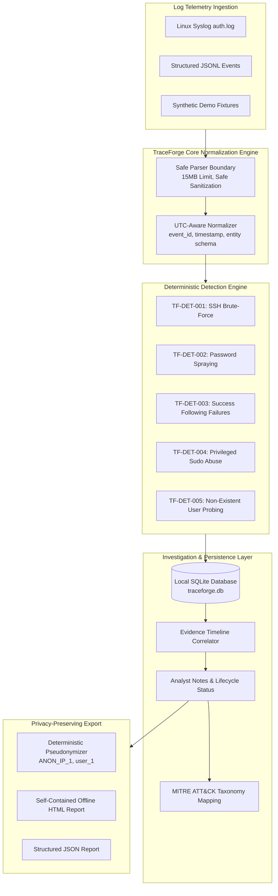

<p align="center">
  
</p>

<h1 align="center">TRACEFORGE // CYBER DEFENSE WORKBENCH</h1>

<p align="center">
  <strong>Defensive Cybersecurity Investigation Workbench for Linux Authentication Logs & Structured Security Events.</strong><br>
  <strong>Engineered & Built by Mouhamed Salim Bousmina</strong>
</p>

<p align="center">
  <a href="LICENSE"></a>
  <a href="LICENSE"></a>
  <a href="README.md"></a>
  <a href="README.md"></a>
</p>

---

## 📸 Screenshots & Visual Interface

TraceForge features a high-contrast Cyber SOC command center design (**Pitch Black `#000000`**, vivid **Phosphor Matrix Green `#00ff66`**, and danger **Crimson Red `#ff1744`**):

### 1. 3D Threat Telemetry & SOC Command Overview
Interactive 3D threat vector globe with real-time incident counters, attack trajectories, and targeted account monitoring.


### 2. Incident Response Investigation Workbench & MITRE ATT&CK Evidence Timeline
Deep-dive evidence correlation engine analyzing Linux authentication logs, brute-force indicators, privilege escalations, and analyst triage notes.


---

## 🎯 About The Project

**TraceForge** was engineered and built by **Mouhamed Salim Bousmina** as an open-source security investigation workbench designed for cybersecurity students, junior SOC analysts, incident response trainees, and defensive security researchers. It parses Linux `/var/log/auth.log` and structured JSON Lines security events, applies explainable deterministic detection rules, correlates suspicious behavior into an investigation timeline, maps detections to MITRE ATT&CK&reg;, and generates sanitized HTML and JSON investigation reports.

> **Defensive Tool Disclaimer:** TraceForge is an educational and defensive analysis workbench, **not** an enterprise SIEM or automated active-defense agent. It operates in read-only mode, performs zero outbound network calls, and never modifies system firewalls, SSH daemons, or remote infrastructure.

---

## 📐 Architecture



---

## ⚡ Core Features

- **Multi-Format Ingestion**: Supports traditional BSD Syslog, ISO-8601 syslog (`/var/log/auth.log`, `/var/log/secure`), and structured cloud container JSON Lines (`.jsonl`).
- **Resource Safeguards**: Hardened input bounds (15MB file size ceiling, 25,000 maximum event counter), graceful recovery from corrupt/malformed records.
- **Explainable Detection Rules**:
  - `TF-DET-001`: **SSH Brute-Force Activity** (Burst of failed authentications from same IP within configurable window).
  - `TF-DET-002`: **Password Spraying Indicators** (Multiple distinct usernames targeted by a single source).
  - `TF-DET-003`: **Successful Login Following Failures** (Correlated authentication compromise indicator).
  - `TF-DET-004`: **Suspicious Privileged Command Execution** (Sensitive sudo binaries & root shells).
  - `TF-DET-005`: **Non-Existent User Probing** (Scanning invalid user dictionaries).
- **100% Offline & Sovereign Enclave**: Operates completely locally without analytics or mandatory external dependencies.
- **AI Intel — Incident Triage & Threat Intelligence**:
  - Integrated **AI Intel** engine for automated DFIR incident triage, MITRE ATT&CK adversary reconstruction, and hardened Linux remediation CLI generation (`iptables`, `fail2ban`, `usermod`, `sshd_config`).
  - Active Model: **`liquid/lfm-2.5-2.6b:free`** (Free & ultra-fast for triage).
  - Also configurable with other popular threat models (e.g., Llama 3.3 70B, DeepSeek V3, Mistral Large).
  - API keys are stored sovereignly in `.env` (ignored by Git, never committed or leaked to GitHub).
- **Interactive Investigation Workbench**:
  - Chronological evidence timelines displaying correlated raw log messages.
  - MITRE ATT&CK technique breakdown with analytical relationship rationales.
  - Analyst lifecycle triage (`New`, `Triaged`, `Investigating`, `Resolved`, `False Positive`).
  - Persistent analyst observation notes with timestamps and author signatures.
- **Privacy Redaction Engine**: Deterministic pseudonymization replacing sensitive IPs with `ANON_IP_1` and accounts with `user_1` across both data records and log message text, preserving correlation without leaking private identifiers.
- **Self-Contained Reporting**: One-click download of offline-ready HTML reports with strict XSS sanitization, along with structured JSON exports.

---

## 🛠️ Technology Stack

- **Author & Creator**: Mouhamed Salim Bousmina
- **Frontend**: React 19, TypeScript, Vite, Tailwind CSS, Three.js (3D Threat Vector Matrix), Framer Motion, Lucide Icons, Recharts
- **Backend**: Python 3.10+, FastAPI, Pydantic v2, SQLite (WAL mode), pytest, httpx
- **AI Intelligence**: AI Intel Engine powered by `liquid/lfm-2.5-2.6b:free`
- **Full-Stack Runtime**: Express server with Vite middleware proxying to FastAPI backend
- **Audio & Sensory**: Web Audio API cyber synth feedback for threat events

---

## 🚀 Installation & Setup

### Prerequisites

- **Python**: 3.10 or higher
- **Node.js**: v20 or higher
- **Git**

### Quick Start

```bash
# 1. Clone the repository
git clone https://github.com/example/traceforge.git
cd traceforge

# 2. Install dependencies
npm install
python3 -m pip install -e ".[dev]"

# 3. Start development server (Port 3000)
npm run dev
```

The application will be accessible at `http://localhost:3000`.

---

## 🐙 Publishing to GitHub (100% Clean Standalone Repository)

To push TraceForge to your personal GitHub without any template banners or external provenance:

```bash
# 1. Create a new empty repository on GitHub (e.g. https://github.com/<username>/traceforge)
#    Ensure "Add a README file" is unchecked and do NOT create from any template.

# 2. In your local project directory:
git init
git add .
git commit -m "feat: initial release of TraceForge Security Workbench by Mouhamed Salim Bousmina"
git branch -M main
git remote add origin https://github.com/<username>/traceforge.git
git push -u origin main --force
```

> **Template Notice**: By pushing as a clean independent repository using the commands above, GitHub treats it as a 100% original standalone project and will **never** display any `"Generated from ..."` banner.

---

## 💻 CLI Usage (Headless Analysis)

TraceForge includes a command-line tool for headless log auditing:

```bash
# Analyze a Linux auth.log and export sanitized reports
python3 -m backend.app.cli \
  --input sample-data/auth_synthetic.log \
  --html-report ./incident_report.html \
  --json-report ./incident_report.json \
  --redact
```

---

## 🧪 Automated Testing

TraceForge includes automated unit, integration, and security tests:

```bash
# Run complete Python test suite
python3 -m pytest backend/tests -v

# Run Frontend TypeScript typechecking & linting
npm run lint

# Build production bundle
npm run build
```

---

## 🔍 Sample Investigation Walkthrough

1. **Load Demonstration Data**: Click **Load Demo Data** in the top navigation bar. TraceForge ingests `sample-data/auth_synthetic.log` containing 29 events.
2. **Review High-Priority Alerts**: The Overview dashboard immediately highlights `TF-DET-003` (*Successful Login Following Repeated Failures* - Critical) from IP `198.51.100.99`.
3. **Open Investigation**: Click **Investigate** on the finding card.
4. **Examine Supporting Evidence**: The chronological evidence timeline displays 4 rapid authentication failures on account `deploy` followed directly by `Accepted password for deploy from 198.51.100.99 port 53110 ssh2`.
5. **Correlate Privilege Elevation**: Notice subsequent finding `TF-DET-004` where user `deploy` ran `sudo: deploy : COMMAND=/bin/bash` to gain an interactive root shell.
6. **Triage & Annotate**: Update finding status to `Investigating` and attach an analyst note: *"Potential compromised credential; user confirmed unauthorized login from external IP"*.
7. **Generate Export**: Go to **Reports**, enable **Redact IP Addresses**, and download the standalone self-contained HTML report.

---

## 🛡️ Privacy & Security Threat Model

| Threat / Risk | TraceForge Defensive Control |
| ------------- | ---------------------------- |
| **Telemetry Leaks** | Zero outbound requests. Runs completely offline; no tracking or cloud AI endpoints. |
| **Sensitive PII Exposure** | Deterministic pseudonymization (`ANON_IP_1`, `user_1`) redacting entities across all fields and messages. |
| **Denial of Service (DoS)** | 15MB file size limit and 25,000 event limit prevent memory exhaustion. |
| **Log Injection / XSS** | All log messages, raw records, and entity strings are strictly HTML-escaped (`html.escape`) before rendering. |
| **Destructive Actions** | Read-only workbench. Zero active firewall modifications or shell executions on target systems. |

---

## 👤 Author & Maintainer

**Mouhamed Salim Bousmina**  
- **Lead Developer & System Architect**  
- **Project**: TraceForge Security Investigation Workbench  
- **Email**: bousminaselim@gmail.com  

---

## 📜 License

TraceForge is released under the [MIT License](LICENSE).  
Copyright &copy; 2026 **Mouhamed Salim Bousmina**. All rights reserved.
